# Agenda de Contactos

Laboratorio de Java sobre el Framework de Colecciones. La aplicacion permite agregar, buscar, eliminar y listar contactos, organizarlos en grupos y mantener un historial en orden de insercion. Se maneja desde un menu de consola.

## Estructura del proyecto

```
Contacto.java        Datos de un contacto (nombre, telefono, email)
Agenda.java          Logica: contactos, grupos e historial
MenuPrincipal.java   Menu interactivo por consola
```

## Colecciones utilizadas

| Estructura | Implementacion | Uso |
|------------|----------------|-----|
| `Map<String, Contacto>` | `TreeMap` | Busqueda por nombre y orden alfabetico |
| `Set<String>` | `TreeSet` | Grupos unicos y ordenados |
| `Map<String, Set<String>>` | `TreeMap` de `TreeSet` | Grupo y nombres de sus contactos |
| `List<Contacto>` | `ArrayList` | Historial en orden de insercion |

## Como ejecutar

```bash
javac Contacto.java Agenda.java MenuPrincipal.java
java MenuPrincipal
```

## Pruebas

Cada prueba incluye el resultado esperado y la captura de la ejecucion.

### 1. Agregar contacto nuevo
Resultado esperado: `Contacto agregado: X`

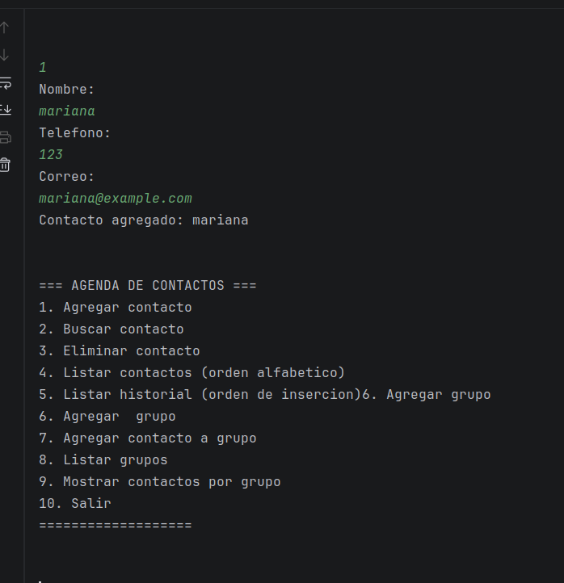

### 2. Agregar contacto duplicado
Resultado esperado: `Error: Ya existe un contacto con el nombre 'X'`

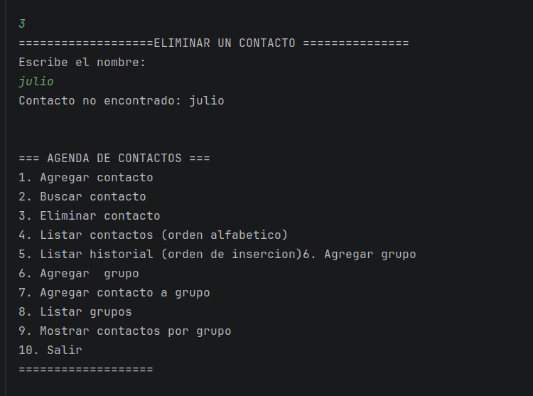

### 3. Buscar contacto existente
Resultado esperado: se muestra el contacto.

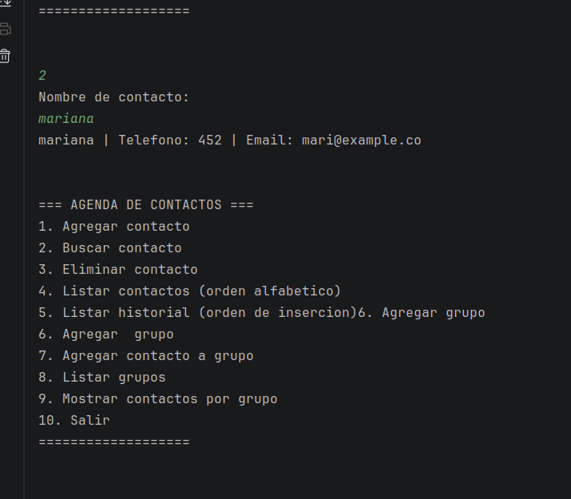

### 4. Buscar contacto inexistente
Resultado esperado: `Contacto no encontrado: X`

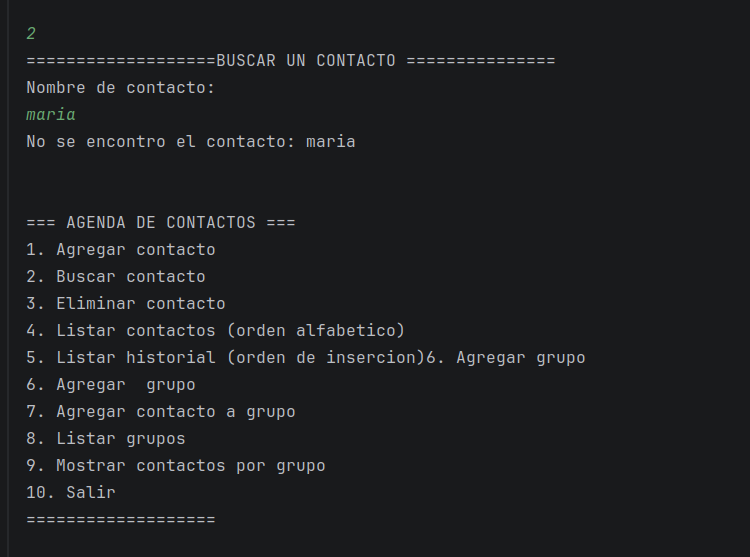

### 5. Eliminar contacto existente
Resultado esperado: `Contacto eliminado: X`

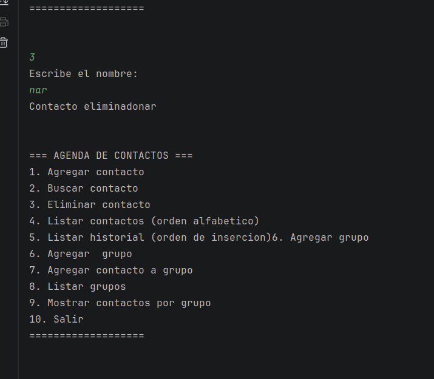

### 6. Eliminar contacto inexistente
Resultado esperado: `Contacto no encontrado: X`

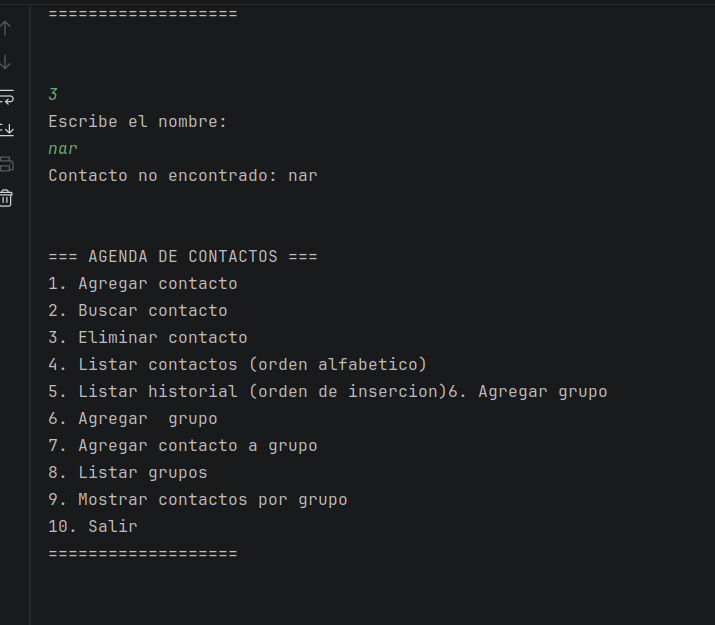

### 7. Listar contactos
Resultado esperado: contactos en orden alfabetico.

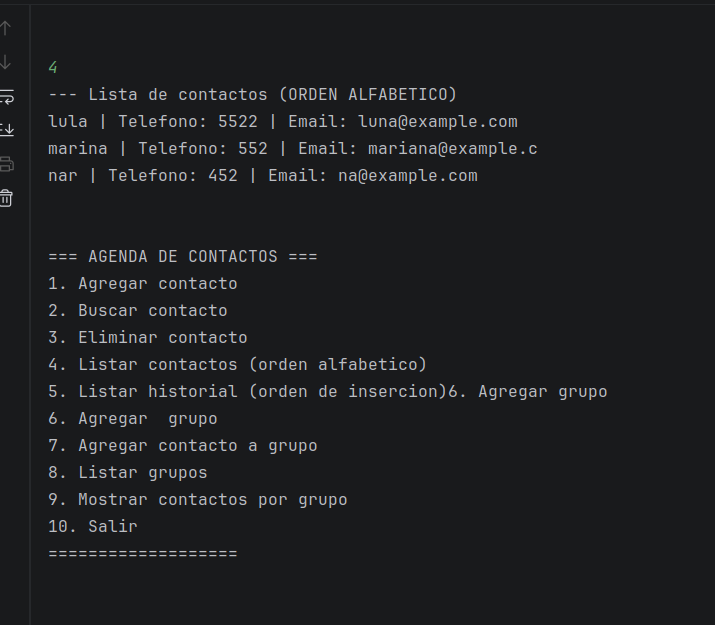

### 8. Listar historial
Resultado esperado: contactos en orden de insercion.

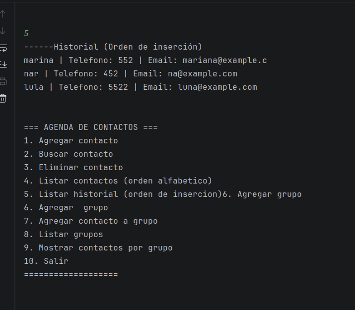

### 9. Agregar grupo nuevo
Resultado esperado: `Grupo 'X' creado`

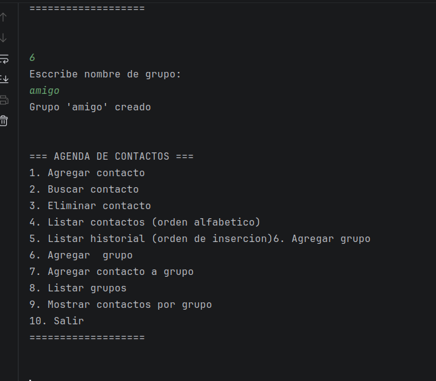

### 10. Agregar grupo duplicado
Resultado esperado: `Error: El grupo 'X' ya existe`

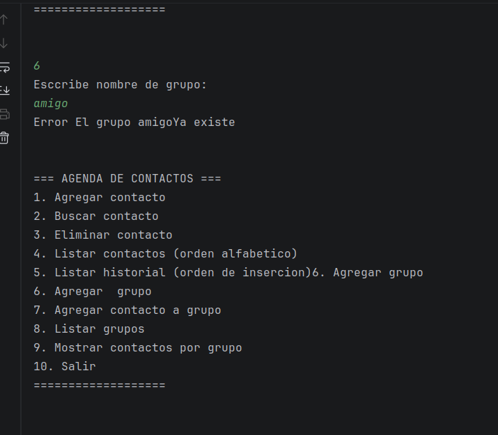

### 11. Agregar contacto a grupo existente
Resultado esperado: `Contacto agregado al grupo 'X'`

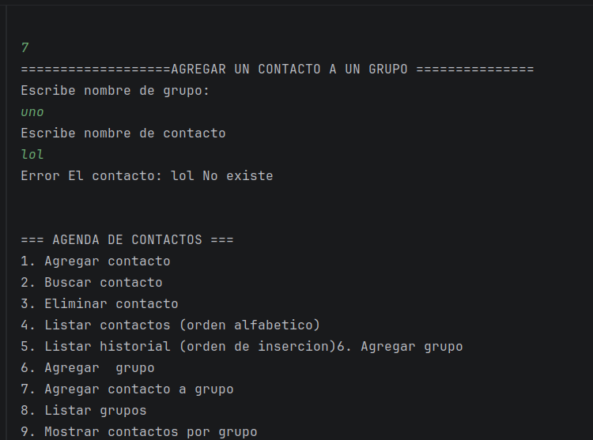

### 12. Agregar contacto inexistente a grupo
Resultado esperado: `Error: El contacto 'X' no existe`

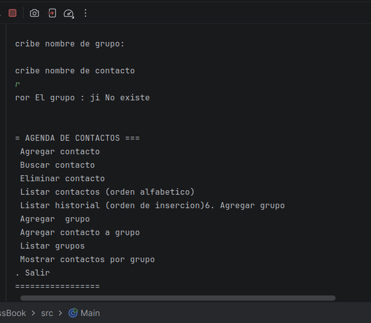

### 13. Agregar contacto a grupo inexistente
Resultado esperado: `Error: El grupo 'X' no existe`


### 14. Mostrar contactos de un grupo con contactos
Resultado esperado: lista de los contactos del grupo.

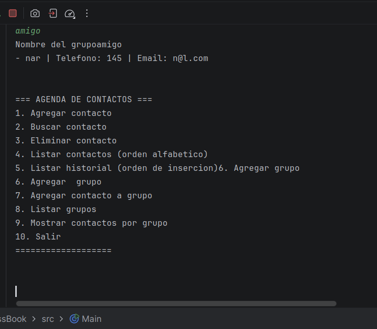

### 15. Mostrar contactos de un grupo vacio
Resultado esperado: `El grupo 'X' no tiene contactos`

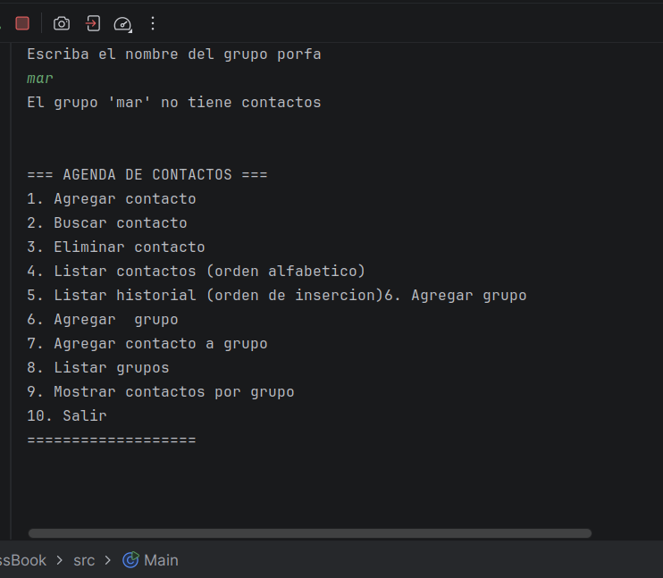

### 16. Mostrar contactos de un grupo inexistente
Resultado esperado: `Error: El grupo 'X' no existe`

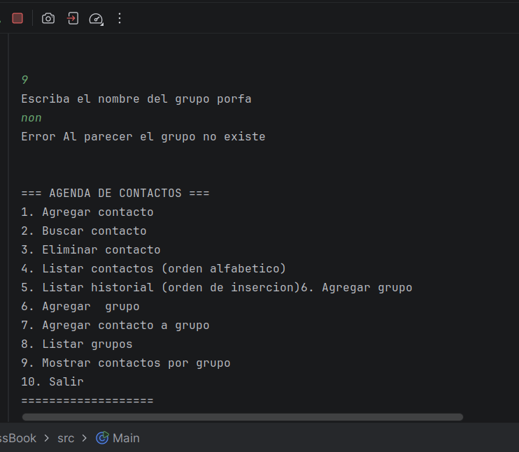

### 17. Eliminar un contacto que esta en grupos
Resultado esperado: se elimina del mapa, del historial y de todos los grupos.


### 18. Opcion invalida (letra)
Resultado esperado: `Opcion invalida, intenta de nuevo`

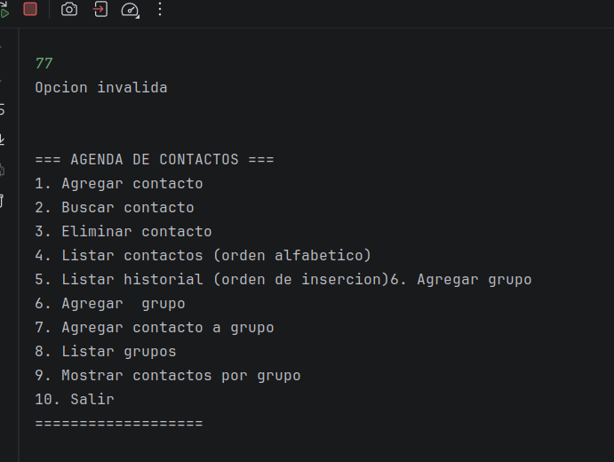

### 19. Opcion fuera de rango
Resultado esperado: `Opcion invalida, intenta de nuevo`


### 20. Salir del menu
Resultado esperado: `Saliendo de la agenda...`

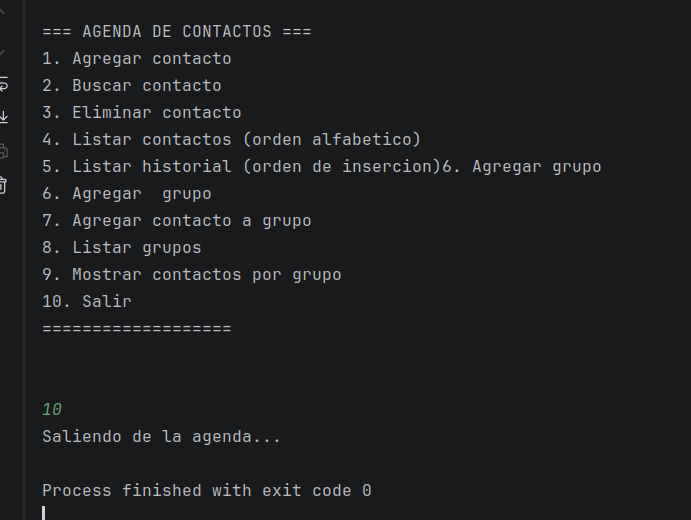